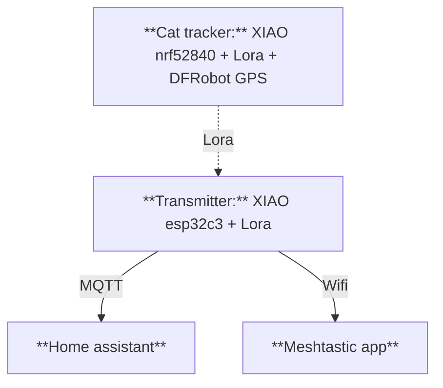

  
  ### GPS cat tracker
  A tiny private meshtastic node with a XIAO, to help me find my young cat when she go out.

------
### ✏️ how it works

The system can be describes with this simple diagram :

### 📷️ screenshots

